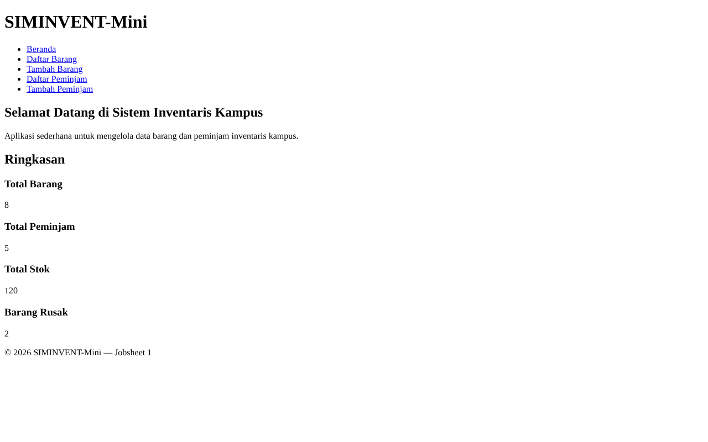
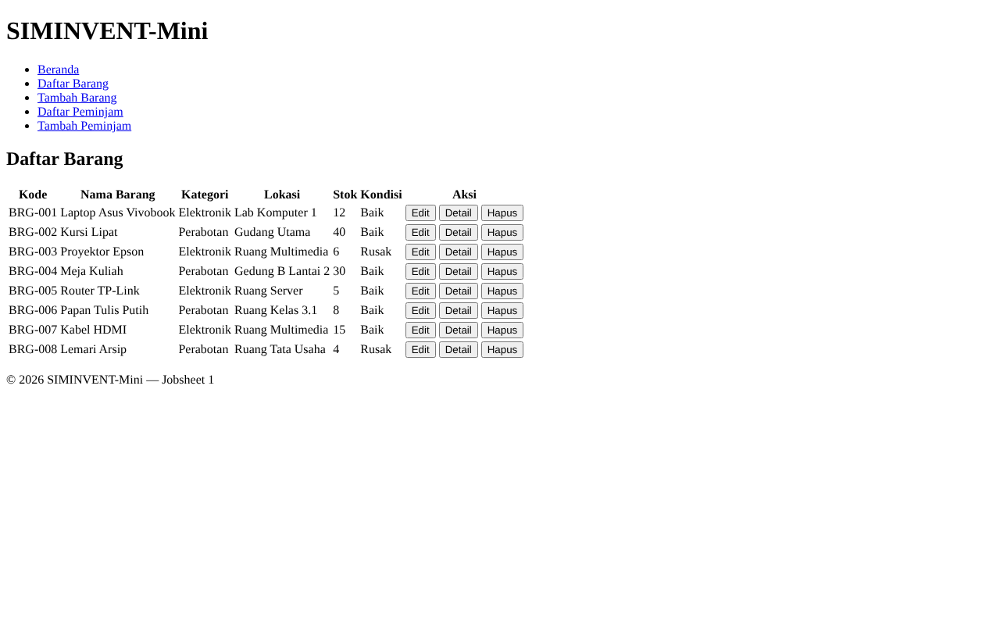
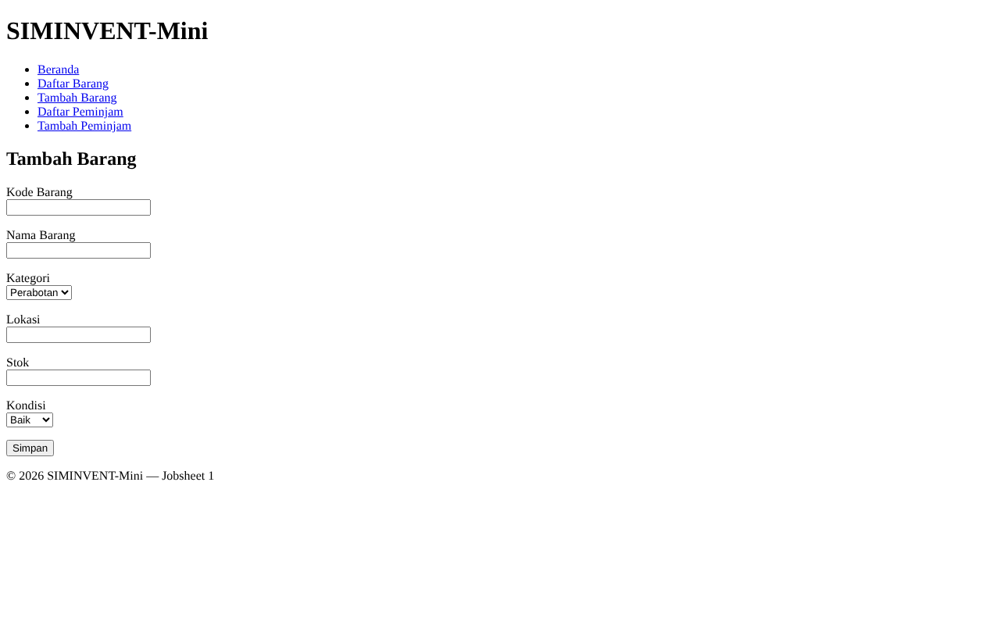
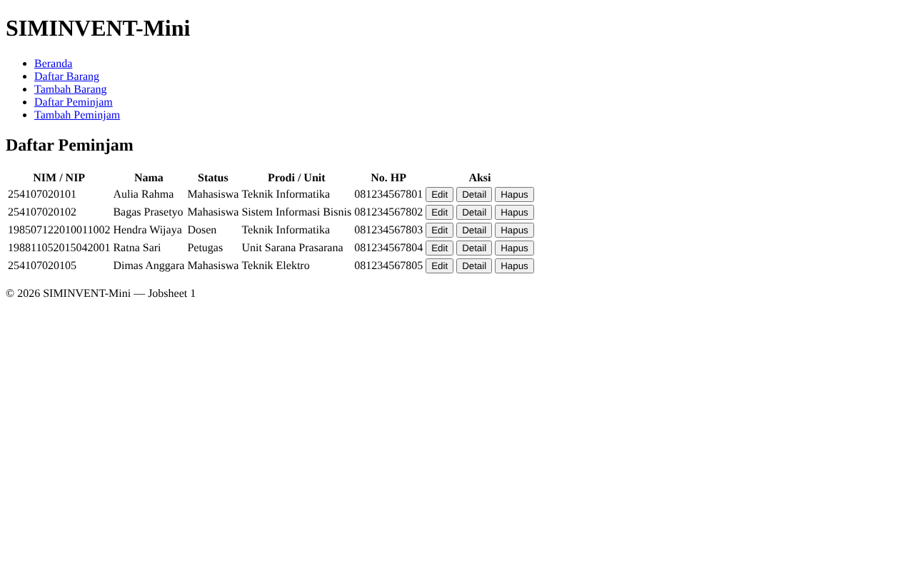
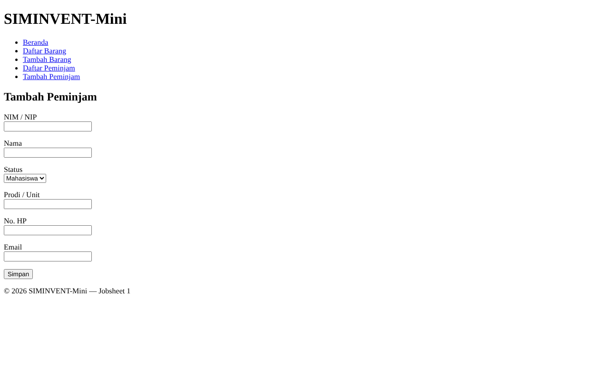

# Desain-Pemrograman-Web

# Jobsheet 01

Jobsheet ini berisi implementasi awal sistem pengelolaan inventaris kampus (SIMINVENT-Mini) yang mencatat data barang dan peminjam. Halaman dibuat dengan HTML saja, tanpa CSS.

## Identitas

| Data | Keterangan |
|---|---|
| Nama | Daffa Rajendra Maulana |
| NIM | 254107020181 |
| Mata Kuliah | Desain Pemograman Web |
| Kelas | TI - 2D |

## Struktur Folder

```
jobsheet-01/
├── index.html          → halaman beranda
├── barang/
│   ├── list.html        → tabel daftar barang
│   └── tambah.html      → form tambah barang (belum diproses)
├── peminjam/
│   ├── list.html        → tabel daftar peminjam
│   └── tambah.html      → form tambah peminjam (belum diproses)
├── README.md
└── dokumentasi/         → dokumentasi pendukung jobsheet
```

## Isi Halaman

| Halaman | Isi |
|---|---|
| Beranda | Sambutan dan ringkasan (total barang, total peminjam, total stok, barang rusak) |
| Daftar Barang | Tabel kode, nama barang, kategori, lokasi, stok, kondisi, dan tombol Edit, Detail, dan Hapus |
| Tambah Barang | Form kode barang, nama barang, kategori, lokasi, stok, dan kondisi |
| Daftar Peminjam | Tabel NIM atau NIP, nama, status, prodi atau unit, nomor HP, dan tombol Edit, Detail, dan Hapus |
| Tambah Peminjam | Form NIM atau NIP, nama, status, prodi atau unit, nomor HP, dan email |

## Tata Letak

Karena jobsheet ini belum memakai CSS, tata letak ditentukan oleh struktur HTML:

- `<header>` berisi nama aplikasi dan `<nav>` dengan lima tautan.
- `<main>` dibagi menjadi dua `<section>`: sambutan dan ringkasan.
- Setiap angka ringkasan berada dalam satu `<article>`.
- Data ditampilkan dengan `<table>`, sedangkan input memakai `<form>` dengan `<label>`, `<input>`, dan `<select>`.
- `<footer>` menutup halaman.

## Cara Menjalankan

Buka file `index.html` melalui browser.

## Dokumentasi

### Beranda


### Daftar Barang


### Tambah Barang


### Daftar Peminjam


### Tambah Peminjam

