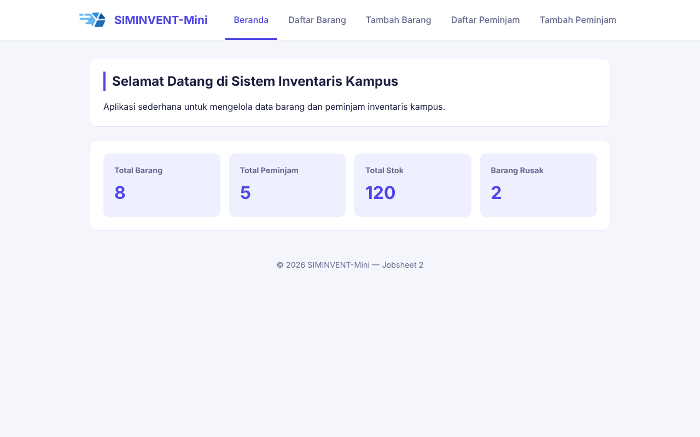
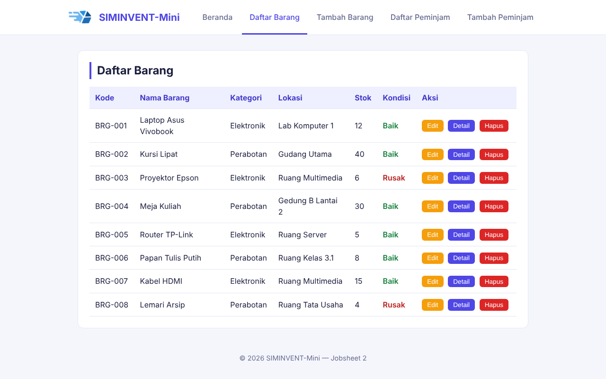
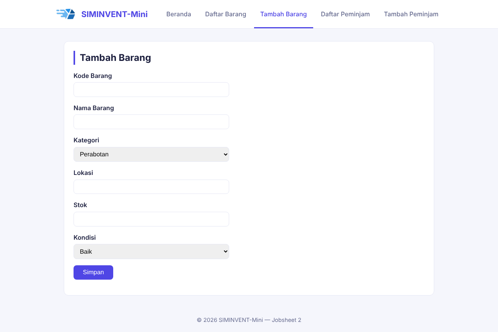
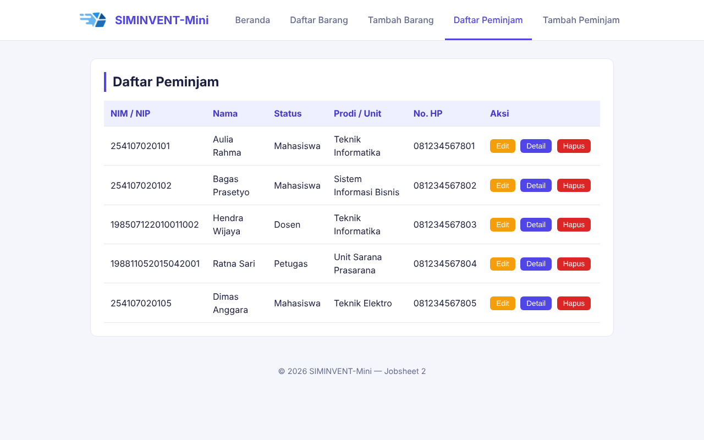
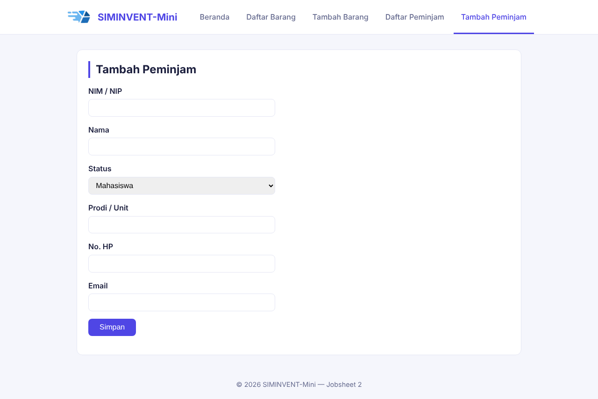

# Desain-Pemrograman-Web

# Jobsheet 02

Jobsheet ini berisi penerapan CSS (layout, warna, dan grid) pada sistem pengelolaan inventaris kampus (SIMINVENT-Mini).

## Identitas

| Data | Keterangan |
|---|---|
| Nama | Daffa Rajendra Maulana |
| NIM | 254107020181 |
| Mata Kuliah | Desain Pemograman Web |
| Kelas | TI - 2D |

## Struktur Folder

```
jobsheet-02/
├── index.html          → halaman beranda
├── assets/
│   ├── css/style.css    → file utama styling
│   └── img/             → logo dan favicon
├── barang/
│   ├── list.html        → tabel daftar barang
│   └── tambah.html      → form tambah barang
├── peminjam/
│   ├── list.html        → tabel daftar peminjam
│   └── tambah.html      → form tambah peminjam
├── README.md
└── dokumentasi/         → dokumentasi pendukung jobsheet
```

## Tata Letak dan Desain

| Elemen | Rancangan |
|---|---|
| Header | Putih dengan garis bawah, logo dan nama di kiri, lima menu berbentuk tab tepat di sampingnya, satu baris dan berada di tengah halaman |
| Menu aktif | Teks indigo dengan garis bawah indigo |
| Lebar konten | Dibatasi 1000px dan diletakkan di tengah halaman |
| Konten | Kartu putih bersudut membulat dengan judul bergaris indigo di sisi kiri |
| Kartu ringkasan | Empat kartu indigo muda dalam satu baris |
| Tabel | Header indigo muda, baris berubah warna saat di-hover |
| Warna utama | Indigo `#4f46e5` |
| Latar halaman | `#f5f6fc` |

## Status Pengerjaan

- Styling dasar (reset, variabel warna, layout header, main, dan footer) diterapkan lewat `style.css`.
- Header memakai Flexbox satu baris (`justify-content: center`): logo di kiri dan menu di sampingnya, dan menu turun ke baris baru saat layar sempit (`flex-wrap`).
- Kartu ringkasan di Beranda memakai CSS Grid empat kolom.
- Tabel data diberi gaya hover baris, dan kondisi barang diberi warna (hijau untuk Baik, merah untuk Rusak).
- Tombol Edit, Detail, dan Hapus pada tabel diberi warna berdasarkan class (`btn-edit`, `btn-detail`, `btn-hapus`), bukan berdasarkan posisi.
- Warna disimpan sebagai variabel CSS (`--indigo`, `--teks`, dan seterusnya) di `:root`.

## Cara Menjalankan

Buka file `index.html` melalui browser.

## Dokumentasi

### Beranda


### Daftar Barang


### Tambah Barang


### Daftar Peminjam


### Tambah Peminjam

