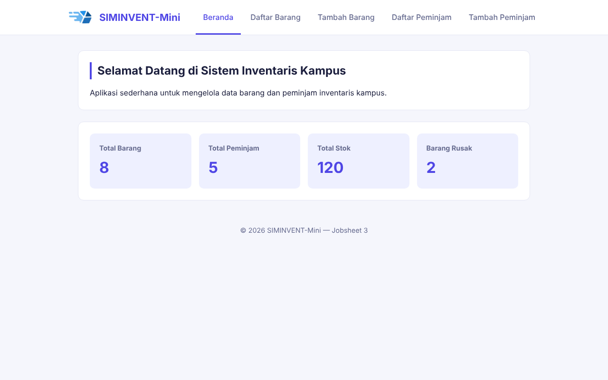
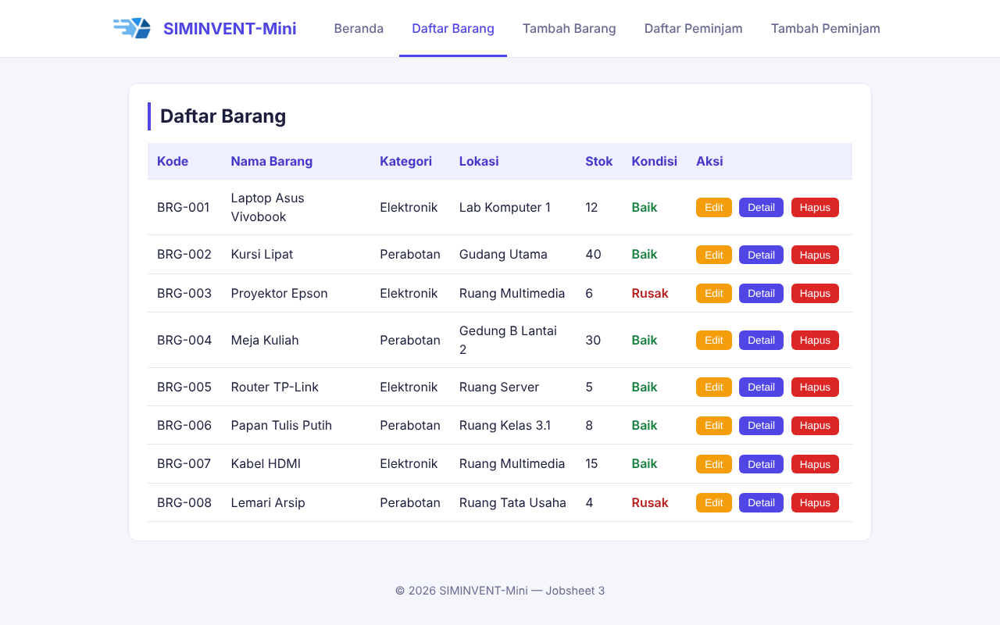
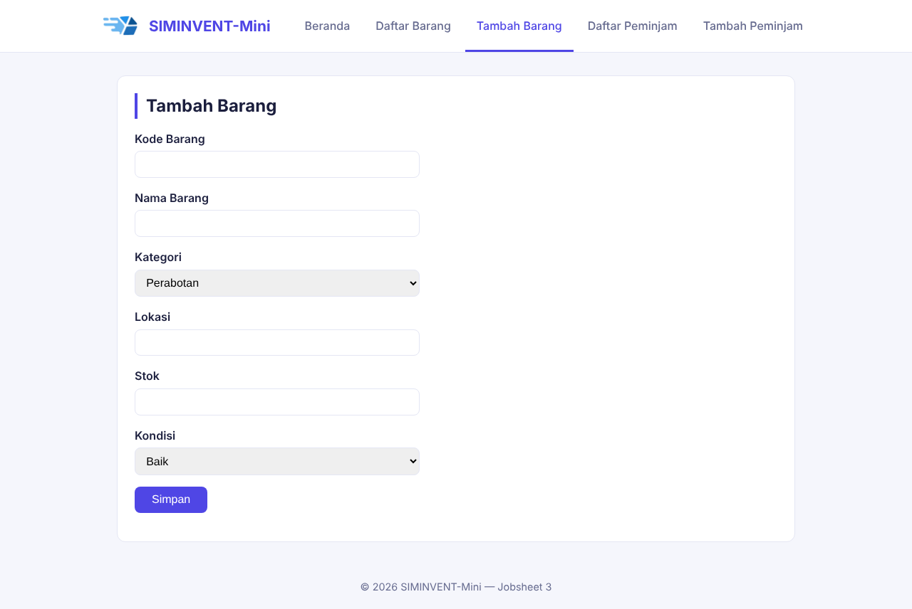
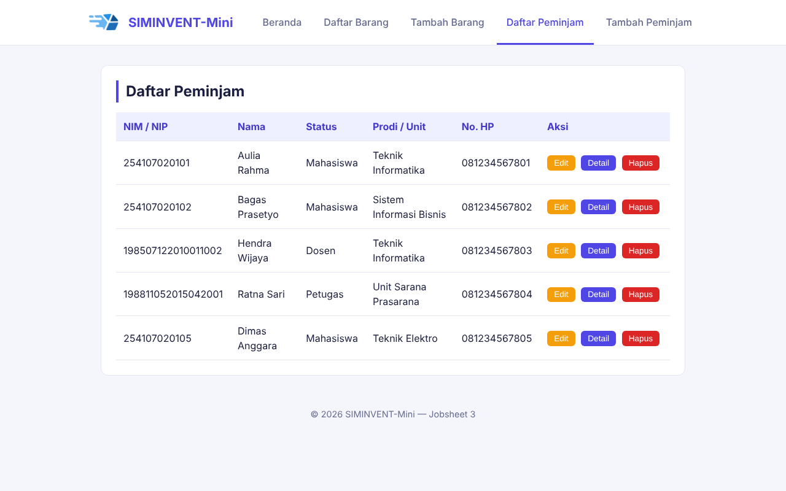
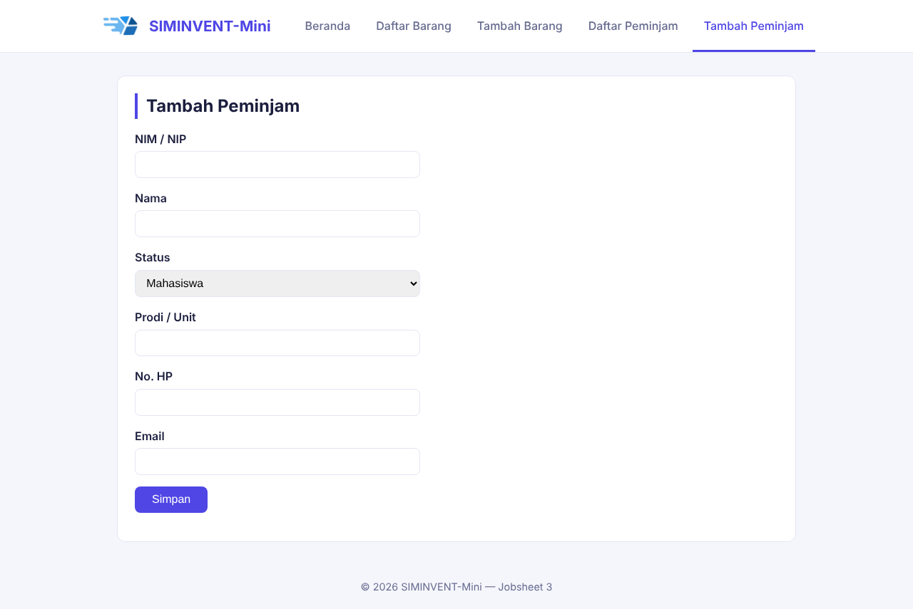
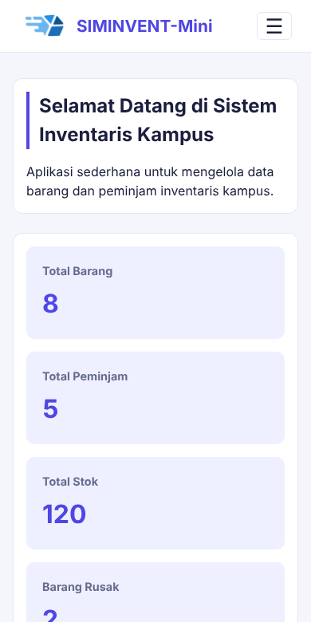
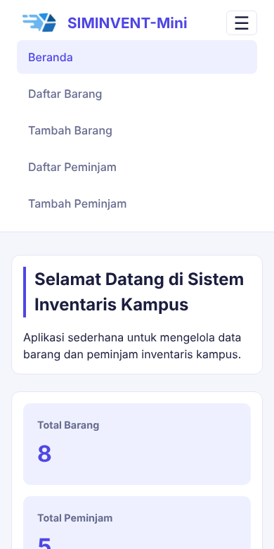

# Desain-Pemrograman-Web

# Jobsheet 03

Jobsheet ini berisi penerapan **Responsive Web Design (RWD)** pada sistem pengelolaan inventaris kampus (SIMINVENT-Mini), meliputi penggunaan meta viewport, media query, breakpoint, dan pendekatan desktop-first.

## Identitas

| Data | Keterangan |
|---|---|
| Nama | Daffa Rajendra Maulana |
| NIM | 254107020181 |
| Mata Kuliah | Desain Pemograman Web |
| Kelas | TI - 2D |

## Struktur Folder

```
jobsheet-03/
├── index.html          → halaman beranda
├── assets/
│   ├── css/style.css    → file utama styling (termasuk media query)
│   └── img/             → logo dan favicon
├── barang/
│   ├── list.html        → tabel daftar barang
│   └── tambah.html      → form tambah barang
├── peminjam/
│   ├── list.html        → tabel daftar peminjam
│   └── tambah.html      → form tambah peminjam
├── README.md
└── dokumentasi/         → dokumentasi pendukung jobsheet
```

## Konsep yang Dipelajari

### 1. Responsive Web Design (RWD)
Pendekatan membangun halaman web agar tata letaknya menyesuaikan diri secara otomatis dengan lebar layar perangkat (HP, tablet, laptop, monitor besar) menggunakan satu file HTML/CSS yang sama, tanpa perlu membuat versi terpisah untuk tiap perangkat.

### 2. Pendekatan Desktop-First
Jobsheet ini memakai strategi **desktop-first**: gaya default untuk layar besar (grid empat kolom, navbar horizontal, dan seterusnya) ditulis lebih dulu, lalu ditimpa sebagian melalui blok `@media (max-width: ...)` di bagian **paling bawah** file `style.css` untuk menyesuaikan tampilan di layar sempit. Urutan ini penting karena pada spesifisitas selector yang sama, aturan yang ditulis paling akhir dalam file yang menang.

### 3. Breakpoint yang Dipakai

| Lebar layar | Perubahan |
|---|---|
| 768px ke bawah | Menu disembunyikan dan diganti tombol hamburger, kartu ringkasan jadi 2 kolom |
| 480px ke bawah | Kartu ringkasan jadi 1 kolom, jarak tepi dikecilkan, input form selebar layar |

## Tata Letak dan Desain

| Elemen | Rancangan |
|---|---|
| Header | Putih dengan garis bawah, logo dan nama di kiri, lima menu berbentuk tab tepat di sampingnya, satu baris dan berada di tengah halaman |
| Menu aktif | Teks indigo dengan garis bawah indigo |
| Konten | Kartu putih bersudut membulat dengan judul bergaris indigo di sisi kiri, lebar dibatasi 1000px dan diletakkan di tengah |
| Kartu ringkasan | Empat kartu indigo muda dalam satu baris |
| Tabel | Header indigo muda, tombol Edit, Detail, dan Hapus berwarna |
| Warna utama | Indigo `#4f46e5` |
| Latar halaman | `#f5f6fc` |

## Status Pengerjaan

- Meta `viewport` sudah ditambahkan di setiap halaman HTML.
- Media query untuk breakpoint 768px dan 480px sudah diterapkan di `style.css` (total 320 baris CSS).
- Header berubah menjadi menu hamburger (checkbox hack) di bawah 768px. Di antara 768px dan sekitar 1000px, menu turun ke baris di bawah logo karena `flex-wrap`.
- Kartu ringkasan (CSS Grid) menyesuaikan jumlah kolom sesuai lebar layar.
- Tabel data dibungkus `.table-responsive` agar bisa di-scroll horizontal di layar sempit.
- Input form menjadi selebar layar di layar mobile.

## Cara Menjalankan

Buka file `index.html` melalui browser, lalu coba ubah ukuran jendela browser (atau buka lewat DevTools mode responsive) untuk melihat perubahan tampilan di breakpoint tablet dan mobile.

## Dokumentasi

### Beranda


### Daftar Barang


### Tambah Barang


### Daftar Peminjam


### Tambah Peminjam


### Tampilan mobile


### Menu hamburger terbuka

