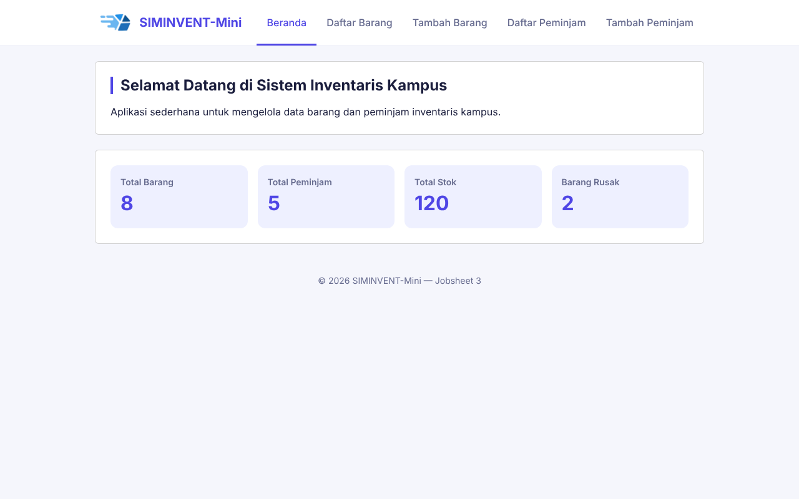
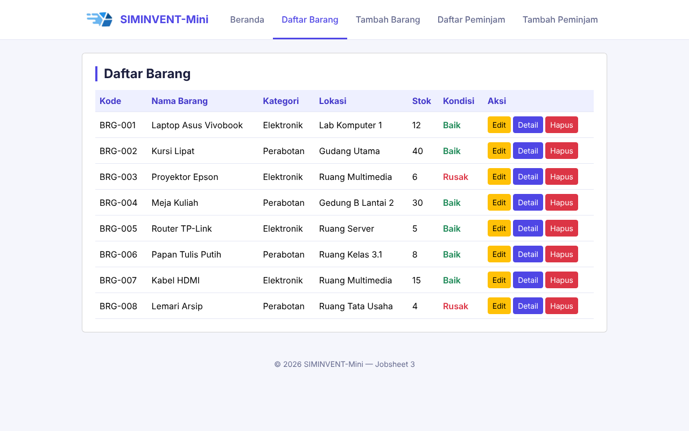
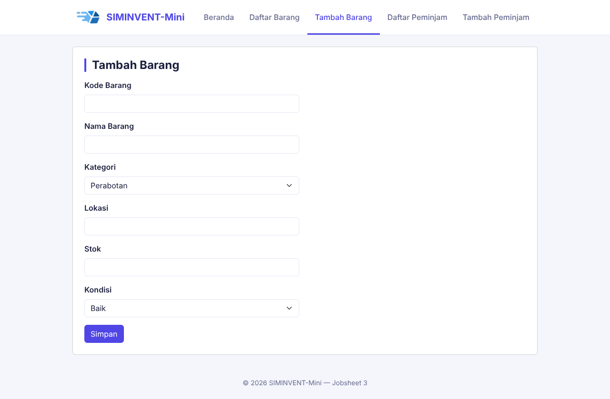
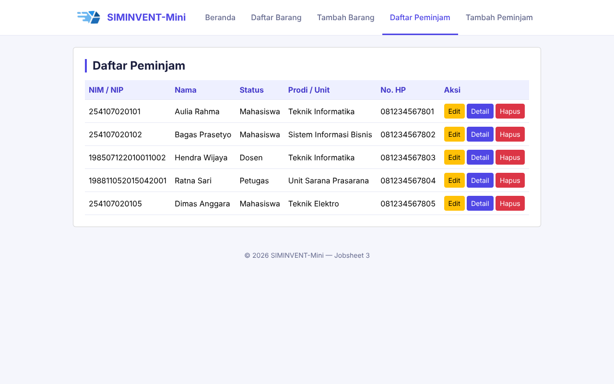
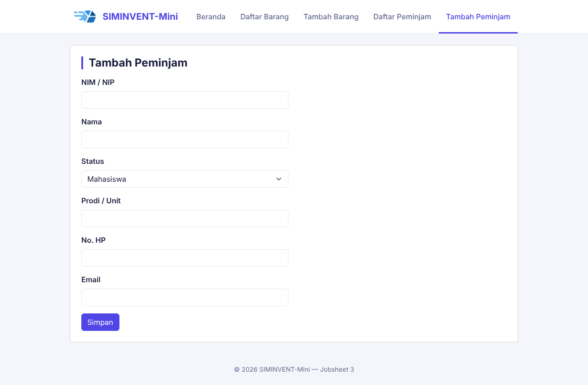
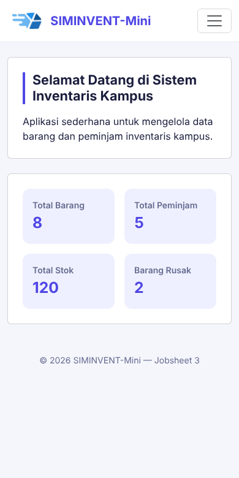

# Desain-Pemrograman-Web

# Jobsheet 03 (Bootstrap)

Jobsheet ini berisi penerapan **Responsive Web Design (RWD)** pada SIMINVENT-Mini memakai framework Bootstrap 5.

## Identitas

| Data | Keterangan |
|---|---|
| Nama | Daffa Rajendra Maulana |
| NIM | 254107020181 |
| Mata Kuliah | Desain Pemograman Web |
| Kelas | TI - 2D |

## Dokumentasi Jobsheet 3 (Versi Bootstrap)

Ini adalah **versi alternatif** dari [jobsheet-03](../jobsheet-03/README.md) yang memakai CSS murni (hand-written CSS). Fungsionalitas dan halamannya **identik**: Beranda, Daftar Barang, Tambah Barang, Daftar Peminjam, Tambah Peminjam. Tata letak dan komponen visualnya dibangun ulang memakai **framework CSS Bootstrap 5**, bukan CSS custom dari nol.

## Kenapa Ada Dua Versi?

Tujuannya supaya kamu bisa membandingkan langsung **dua pendekatan** untuk mencapai hasil visual yang mirip:

| | Jobsheet 3 (CSS Murni) | Jobsheet 3 (Bootstrap) |
|---|---|---|
| Layout | `display: flex`, `display: grid` ditulis manual | `.row` dan `.col-*` (grid 12 kolom Bootstrap) |
| Navbar dan hamburger | Checkbox hack (`:checked` dan sibling combinator `~`) | Komponen `.navbar` bawaan, dibuka tutup oleh JavaScript Bootstrap |
| Kartu | `<section class="kartu">` dengan CSS custom (`border-radius` dan `border` manual) | Komponen `.card` bawaan |
| Tabel | `<table>` dengan CSS custom (`:hover`, padding sel) | Class `.table`, `.table-hover`, `.table-light` |
| Warna kondisi | `.baik` dan `.rusak` ditulis manual | `.text-success` dan `.text-danger` |
| Form | `<input>` dan `<select>` dengan CSS custom | Class `.form-control`, `.form-select`, `.form-label` |
| Breakpoint | Ditulis sendiri (`768px`, `480px`) | Bawaan Bootstrap (`sm`, `md`, `lg`, `xl`, `xxl`) |
| Total baris CSS custom | 320 baris (`style.css`) | 82 baris (`style.css`) |

Intinya: **hasil akhirnya bisa mirip, tapi cara mencapainya sangat berbeda.** CSS murni memberi kontrol penuh tapi butuh menulis semua aturan sendiri. Bootstrap memberi banyak komponen dan utility class siap pakai, dengan konsekuensi harus memuat file CSS dan JS tambahan serta mengikuti konvensi nama class-nya. Pada versi Bootstrap, `style.css` hanya berisi warna tema indigo, penyesuaian navbar, dan beberapa penyesuaian kecil lain.

## Struktur Folder

```
jobsheet-03_bootstrap/
├── index.html              → beranda
├── assets/
│   ├── css/style.css        → warna tema dan penyesuaian kecil di atas Bootstrap
│   └── img/                 → logo dan favicon
├── barang/
│   ├── list.html
│   └── tambah.html
├── peminjam/
│   ├── list.html
│   └── tambah.html
├── README.md
└── dokumentasi/             → screenshot hasil
```

## Konsep yang Dipelajari

### 1. Responsive Web Design (RWD) dengan Framework
Tata letak menyesuaikan lebar layar secara otomatis memakai satu file HTML yang sama. Pada jobsheet ini, penyesuaian tersebut tidak ditulis manual lewat CSS, melainkan memanfaatkan sistem grid dan komponen siap pakai dari **Bootstrap 5**.

### 2. Pendekatan Mobile-First Bootstrap
Berbeda dengan desktop-first, Bootstrap menganut strategi **mobile-first**: gaya default suatu elemen berlaku untuk layar kecil, lalu ditambahkan class breakpoint (`md-`, `lg-`, `xl-`) untuk mengubah tampilan saat layar melebar. Contohnya `col-6 col-md-3` pada kartu ringkasan: secara default mengambil 6 dari 12 kolom (dua kartu per baris), lalu menjadi 3 kolom (empat kartu per baris) pada layar `md` (768px ke atas).

### 3. Grid System Bootstrap
Lebar halaman dibagi menjadi 12 kolom virtual lewat kombinasi `container`, `row`, dan `col-*`. Kartu ringkasan memakai empat `col-6 col-md-3`, sedangkan form memakai `col-md-8 col-lg-6` sehingga tidak melebar penuh di layar besar.

### 4. Breakpoint
Titik lebar layar standar Bootstrap: `sm` (576px), `md` (768px), `lg` (992px), `xl` (1200px), dan `xxl` (1400px). Navbar memakai `navbar-expand-xl`, jadi menu terbentang penuh mulai 1200px.

### 5. Utility Classes
Class kecil siap pakai untuk spacing, warna, tipografi, dan tata letak, misalnya `py-5` (padding vertikal), `fw-bold` (tebal), `text-secondary` (warna abu), dan `shadow-sm` (bayangan tipis).

### 6. Navbar Responsif (Collapse Component)
Komponen `navbar` otomatis berubah dari horizontal (layar besar) menjadi menu hamburger (layar kecil) lewat atribut `data-bs-toggle="collapse"` dan `data-bs-target`, tanpa JavaScript tambahan selain `bootstrap.bundle.min.js`.

### 7. Komponen Siap Pakai
`card`, `table`, `btn`, serta class form seperti `form-control` dan `form-select` membuat elemen tampil seragam tanpa styling manual satu per satu.

## Tata Letak dan Desain

| Elemen | Rancangan |
|---|---|
| Header | Putih dengan garis bawah, logo dan nama di kiri, lima menu berbentuk tab tepat di sampingnya, satu baris dan berada di tengah halaman |
| Menu aktif | Teks indigo dengan garis bawah indigo |
| Konten | Kartu putih bersudut membulat dengan judul bergaris indigo di sisi kiri, lebar dibatasi 1000px dan diletakkan di tengah |
| Kartu ringkasan | Empat kartu indigo muda dalam satu baris |
| Tabel | Header indigo muda, tombol Edit, Detail, dan Hapus berwarna |
| Warna utama | Indigo `#4f46e5` |
| Latar halaman | `#f5f6fc` |

## Cara Menjalankan

Buka file `index.html` melalui browser, lalu coba ubah ukuran jendela browser (atau buka lewat DevTools mode responsive) untuk melihat perubahan tampilan di breakpoint tablet dan mobile.

## Dokumentasi

### Beranda


### Daftar Barang


### Tambah Barang


### Daftar Peminjam


### Tambah Peminjam


### Tampilan mobile

