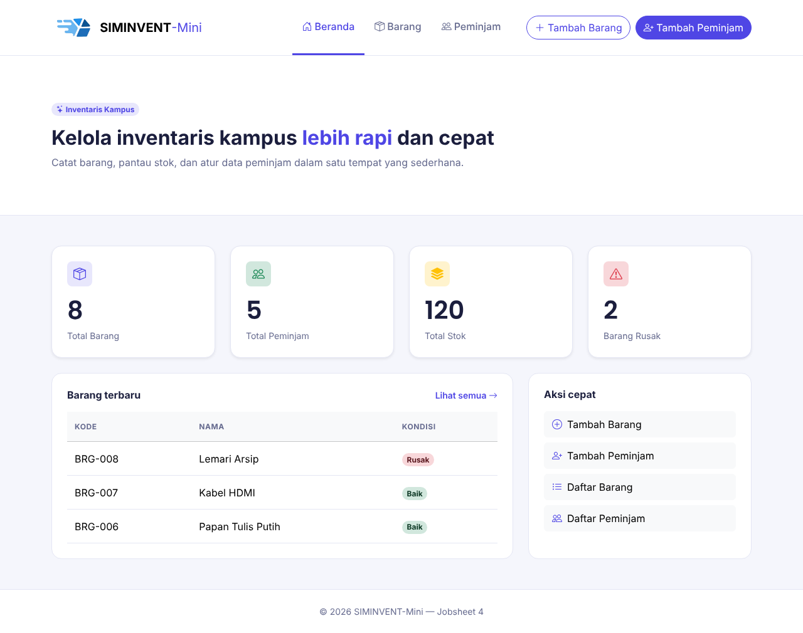
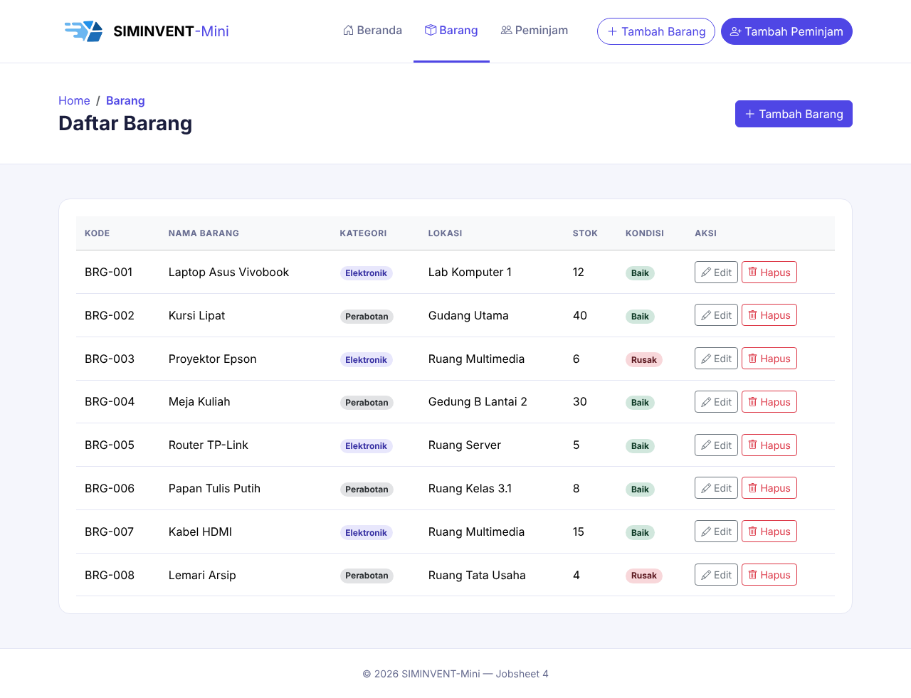
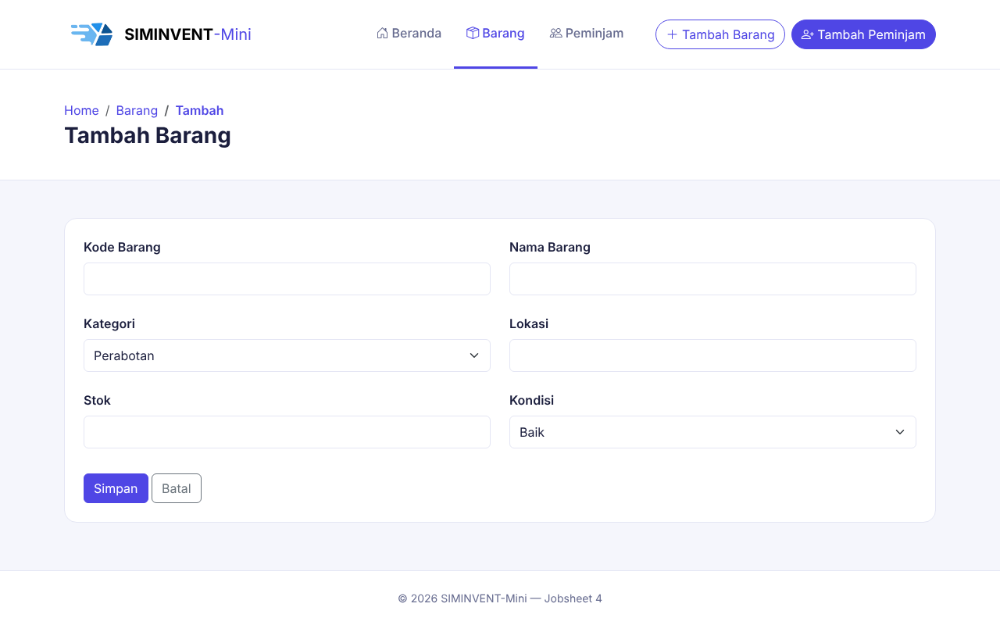
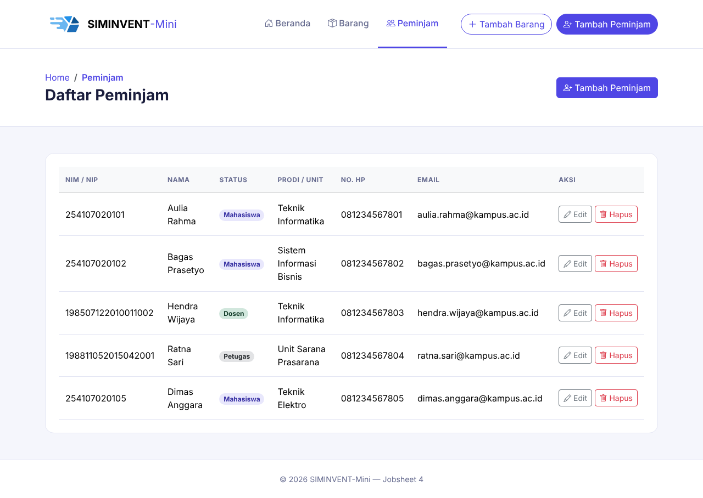
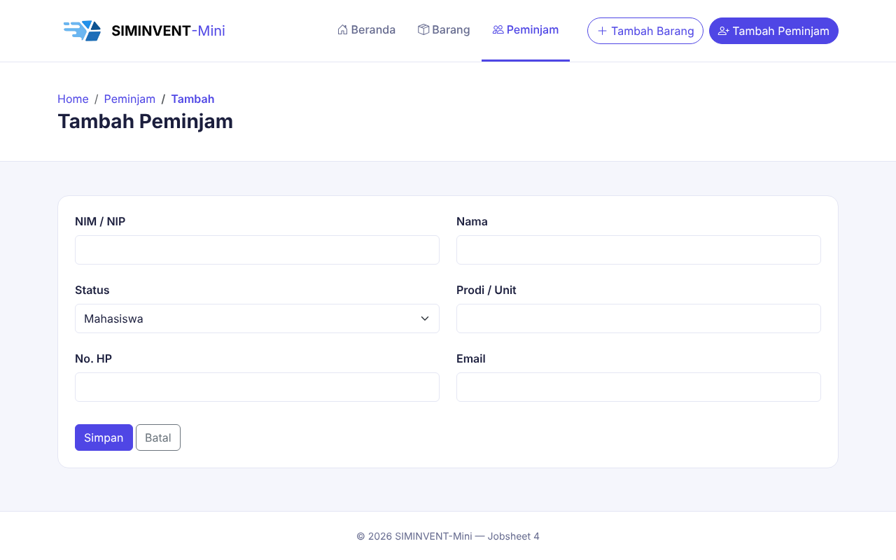

# Desain-Pemrograman-Web

# Jobsheet 4 — UI/UX Design

Sub-CPMK: Merancang UI/UX aplikasi (proyek).

## Identitas

| Data | Keterangan |
|---|---|
| Nama | Daffa Rajendra Maulana |
| NIM | 254107020181 |
| Mata Kuliah | Desain Pemograman Web |
| Kelas | TI - 2D |

## Tujuan

Merancang tampilan dan alur penggunaan **SIMINVENT-Mini** (sistem pengelolaan inventaris kampus) sebelum fitur-fiturnya dibangun. Rancangan berupa aktor, *user flow*, dan wireframe untuk fitur yang belum ada: Login, Dashboard Petugas, Peminjaman, Pengembalian, dan Riwayat.

## Perubahan dari Jobsheet 3

- **Tidak ada perubahan kode.** Halaman HTML dan CSS (Beranda, Daftar Barang, Tambah Barang, Daftar Peminjam, Tambah Peminjam) sama persis dengan Jobsheet 3 versi Bootstrap.
- **Ditambahkan `docs/wireframe.md`**: dokumen rancangan berisi aktor, user flow, wireframe, dan style guide.
- Dokumen tersebut menjadi acuan struktur halaman baru yang akan diimplementasikan pada Jobsheet 5 dan seterusnya.

## Aktor dan Hak Akses

| Aktor | Peran |
|---|---|
| **Tamu** | Pengunjung tanpa login. Hanya dapat melihat daftar barang. |
| **Petugas** | Pengguna yang sudah login. Mengelola barang, peminjam, serta transaksi peminjaman dan pengembalian. |

Tamu yang membuka halaman khusus Petugas diarahkan ke halaman Login.

## Halaman yang Dirancang

| Halaman | Isi utama |
|---|---|
| Login | Form username dan password, pesan error, tautan ke Registrasi |
| Registrasi Petugas | Form nama, username, password, dan konfirmasi password |
| Dashboard Petugas | Tiga kartu statistik, tombol aksi cepat, tabel transaksi terbaru |
| Form Peminjaman | Pilihan peminjam dan barang, peringatan tunggakan, penanda stok habis dan barang rusak |
| Form Pengembalian | Pencarian transaksi aktif, tombol Kembalikan, penanda keterlambatan |
| Riwayat Peminjaman | Histori peminjaman per peminjam |

Wireframe lengkap (ASCII) ada di [`docs/wireframe.md`](docs/wireframe.md).

## User Flow

### Petugas meminjamkan barang
1. Petugas login. Jika data salah, muncul pesan error dan kembali ke halaman Login.
2. Dari Dashboard, petugas memilih **Peminjaman Baru**, lalu memilih peminjam.
3. Jika peminjam memiliki **tunggakan**, peminjaman ditolak dan petugas kembali ke Dashboard.
4. Petugas memilih barang. Jika **stok = 0** atau kondisi **rusak**, muncul pesan dan petugas memilih barang lain.
5. Petugas menekan **Simpan**. Stok berkurang 1, transaksi tercatat, dan muncul pesan sukses.

### Petugas menerima pengembalian barang
1. Dari Dashboard, petugas memilih **Pengembalian**, lalu mencari transaksi berdasarkan nama peminjam atau nama barang.
2. Jika transaksi aktif **tidak ditemukan**, muncul pesan dan petugas mencari ulang.
3. Petugas memilih transaksi dan menekan **Kembalikan**.
4. Jika sudah **melewati jatuh tempo**, transaksi ditandai "Terlambat".
5. Stok bertambah 1, tanggal kembali tercatat, dan muncul pesan sukses.

Diagram alur lengkap dengan percabangan ada di bagian 3 pada `docs/wireframe.md`.

## Skenario Khusus (Edge Case)

| # | Situasi | Perilaku sistem |
|---|---|---|
| 1 | Stok barang = 0 | Barang non-aktif di pilihan dengan label "(Stok habis)" |
| 2 | Barang berkondisi rusak | Barang non-aktif di pilihan dengan label "(Rusak)" |
| 3 | Peminjam punya tunggakan | Peminjaman ditolak dengan pesan alasan |
| 4 | Login gagal | Pesan error umum tanpa menyebut mana yang salah |
| 5 | Tamu membuka halaman Petugas | Diarahkan ke Login |
| 6 | Transaksi sudah dikembalikan | Tidak muncul di pencarian, stok tidak bertambah dua kali |
| 7 | Pengembalian melewati jatuh tempo | Status "Terlambat" dicatat |
| 8 | Data kosong | Tampil teks "Belum ada data" |

## Keselarasan dengan Halaman yang Sudah Ada

- **Navbar sudah seragam.** Semua halaman memakai satu pola: logo, menu Beranda, Barang, dan Peminjam di tengah, serta tombol Tambah Barang dan Tambah Peminjam di kanan. Pola ini dilanjutkan untuk Petugas dengan menambah menu Peminjaman dan Pengembalian.
- **Kartu statistik** di Beranda dipakai ulang pada Dashboard Petugas.
- **Halaman Peminjam** ditambah tombol **Riwayat** di kolom Aksi untuk membuka Riwayat Peminjaman.
- **Gaya visual** mengikuti halaman yang ada: warna utama indigo `#4f46e5`, font Segoe UI, komponen Bootstrap.

<!--
## Mockup Visual (Tugas Mandiri)

Aktifkan bagian ini setelah gambar mockup dibuat: hapus tanda komentar di atas
dan di bawah, lalu pastikan file gambarnya ada di docs/mockup/.

### Login


### Dashboard Petugas

-->

## Struktur Folder

```
jobsheet-04/
├── assets/
│   ├── css/style.css
│   ├── fonts/
│   └── img/
├── barang/
│   ├── list.html
│   └── tambah.html
├── docs/
│   └── wireframe.md       → Rancangan UI/UX (aktor, user flow, wireframe)
├── peminjam/
│   ├── list.html
│   └── tambah.html
├── dokumentasi/           → Screenshot hasil
├── index.html
└── README.md
```

## Cara Melihat Hasil

- **Kode:** sama seperti Jobsheet 3, buka `index.html` di browser.
- **Rancangan:** buka `docs/wireframe.md`. Di VS Code, tekan **Ctrl+Shift+V** untuk membuka tampilan Markdown Preview. Di GitHub, file ini tampil otomatis saat dibuka.

## Dokumentasi

### Beranda


### Daftar Barang


### Tambah Barang


### Daftar Peminjam


### Tambah Peminjam



## Kesimpulan

Rancangan UI/UX yang dibuat memberi gambaran yang jelas tentang siapa saja pengguna sistem, apa yang bisa dilakukan masing-masing, dan bagaimana alur peminjaman serta pengembalian berjalan, termasuk kondisi khusus seperti stok habis, barang rusak, dan peminjam bertunggakan. Dengan menyusun rancangan lebih dulu dan menyelaraskannya dengan halaman yang sudah ada, pembangunan fitur pada jobsheet berikutnya dapat mengikuti struktur yang sama sehingga tampilan dan navigasi tetap konsisten.
