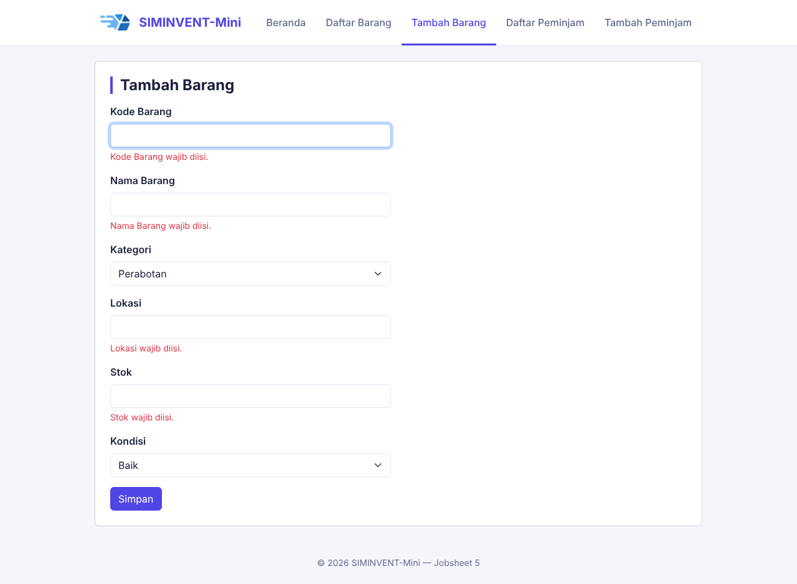
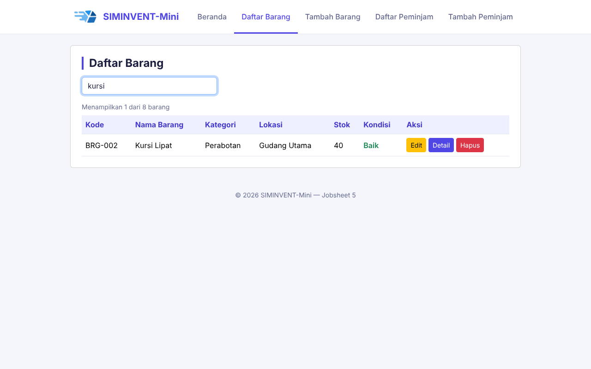
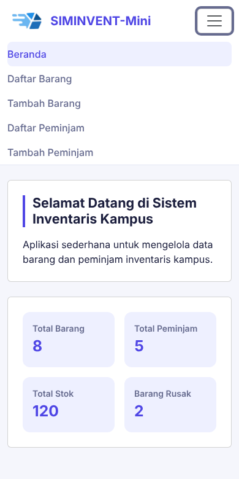

# Desain-Pemrograman-Web

# Jobsheet 5 — JavaScript DOM & Event

Sub-CPMK: Menerapkan manipulasi DOM dan event JavaScript.

## Identitas

| Data | Keterangan |
|---|---|
| Nama | Daffa Rajendra Maulana |
| NIM | 254107020181 |
| Mata Kuliah | Desain Pemograman Web |
| Kelas | TI - 2D |

## Tujuan

Menghidupkan halaman-halaman SIMINVENT-Mini dengan JavaScript di sisi client: menu hamburger, validasi form, pencarian tabel, dan konfirmasi hapus. Semua berjalan di browser tanpa server atau database.

## Perubahan dari Jobsheet 4

- Ditambahkan `assets/js/app.js` dan dihubungkan ke semua halaman lewat `<script src="...app.js">`.
- Hamburger menu digerakkan oleh JavaScript (event `click` dan `classList.toggle`).
- Form Tambah Barang dan Tambah Peminjam diberi validasi client-side dengan pesan error inline.
- Halaman Daftar Barang dan Daftar Peminjam diberi kolom pencarian real-time, counter jumlah baris, dan konfirmasi hapus.

## Fitur yang Dibuat

### 1. Hamburger menu
Tombol `#nav-toggle-btn` memiliki event `click` yang menambah atau menghapus class `show` pada menu `#navMenu`. Karena halaman memakai navbar Bootstrap, class `show` adalah class yang dikenali Bootstrap untuk menampilkan menu. Atribut `data-bs-toggle` dan `data-bs-target` pada tombol dihapus supaya Bootstrap tidak ikut men-toggle dan bertabrakan dengan JavaScript.

### 2. Validasi form Tambah Barang dan Tambah Peminjam
- Form diberi `id="form-tambah"` dan atribut `novalidate` agar validasi bawaan browser tidak mendahului pesan error dari JavaScript.
- Pesan error dibuat lewat DOM (`createElement("span")` dan `insertAdjacentElement`) di bawah field yang salah, dan dihapus saat field sudah benar.
- Kursor otomatis pindah ke field pertama yang salah, dan form tidak terkirim (`preventDefault`) selama masih ada error. Semua berjalan tanpa reload halaman.

| Form | Field | Aturan |
|---|---|---|
| Barang | Kode Barang | Wajib, hanya huruf, angka, dan tanda hubung (-) |
| Barang | Nama Barang, Lokasi | Wajib diisi |
| Barang | Stok | Bilangan bulat, tidak boleh negatif |
| Peminjam | NIM / NIP | Wajib, hanya angka, 8 sampai 20 digit |
| Peminjam | Nama, Prodi / Unit | Wajib diisi |
| Peminjam | No. HP | Wajib, 8-15 karakter (angka, +, -) |
| Peminjam | Email | Wajib, format email valid |

### 3. Pencarian tabel real-time
Kolom cari (`#search-input`) menyaring baris tabel setiap kali ada ketikan (event `keyup`) dengan mengatur `style.display`. Pencarian hanya membaca kolom **Nama Barang** (barang) atau **Nama** (peminjam), bukan seluruh teks baris.

### 4. Konfirmasi hapus
Tombol Hapus (`.btn-hapus`) menampilkan dialog `confirm()` yang menyebut nama barang atau peminjam. Jika dikonfirmasi, baris dihapus dari tampilan. Penghapusan ini belum ke server, jadi data muncul kembali setelah halaman dimuat ulang.

### 5. Tugas mandiri: halaman Peminjam
Validasi (form Tambah Peminjam) dan pencarian (Daftar Peminjam) yang sama diterapkan pada halaman Peminjam. Satu file `app.js` dipakai bersama oleh semua halaman.

## Ide Latihan Tambahan

| # | Latihan | Hasil |
|---|---|---|
| 1 | Validasi field Kode Barang | Kode hanya menerima huruf, angka, dan tanda hubung |
| 2 | Hamburger digerakkan JavaScript | Menu dibuka dan ditutup lewat `classList.toggle("show")` |
| 3 | Pencarian satu kolom | Pencarian hanya pada kolom Nama Barang atau Nama lewat `row.cells[idx]` |
| 4 | Counter baris | Teks "Menampilkan X dari Y barang atau peminjam" di atas tabel, diperbarui saat mencari dan menghapus |
| 5 | Refactor validasi | Aturan field disimpan dalam array `ATURAN` dan divalidasi dengan `forEach`, tanpa blok `if` per field |

## File yang Diubah

| File | Perubahan |
|---|---|
| `assets/js/app.js` | Baru: hamburger, validasi, pencarian, counter, konfirmasi hapus |
| Semua HTML | Tombol hamburger ber-`id="nav-toggle-btn"` tanpa atribut `data-bs-*`, script `app.js` terpasang, footer jadi Jobsheet 5 |
| `barang/list.html`, `peminjam/list.html` | Kolom cari `#search-input`, tombol Hapus ber-class `btn-hapus` |
| `barang/tambah.html`, `peminjam/tambah.html` | `<form id="form-tambah" novalidate>` |

## Struktur Folder

```
jobsheet-05/
├── assets/
│   ├── css/style.css
│   ├── img/
│   └── js/
│       └── app.js
├── barang/
│   ├── list.html
│   └── tambah.html
├── docs/
│   └── wireframe.md
├── dokumentasi/            → Screenshot hasil
├── peminjam/
│   ├── list.html
│   └── tambah.html
├── index.html
└── README.md
```

## Cara Menjalankan dan Menguji

Buka `index.html` di browser, lalu coba:

1. Buka **Tambah Barang** atau **Tambah Peminjam**, kirim form kosong: pesan error muncul di bawah tiap field tanpa reload.
2. Isi Kode Barang dengan tanda baca (misalnya "BRG 001!"): muncul pesan bahwa kode hanya boleh huruf, angka, dan tanda hubung.
3. Buka **Daftar Barang** atau **Daftar Peminjam**, ketik di kolom cari: tabel tersaring dan counter berubah.
4. Klik **Hapus**: muncul dialog konfirmasi, baris hilang jika dikonfirmasi, dan counter berkurang.
5. Kecilkan jendela browser di bawah 1200px, lalu klik tombol hamburger: menu terbuka dan tertutup.
6. Buka Console browser (**F12**) dan pastikan tidak ada error.

## Dokumentasi (Screenshot)

### Pesan error validasi


### Pencarian dan counter


### Menu hamburger (tampilan mobile)



## Kesimpulan

Dengan JavaScript, halaman yang sebelumnya statis menjadi interaktif: pengguna mendapat umpan balik langsung saat mengisi form, dapat mencari data tanpa memuat ulang halaman, dan diminta konfirmasi sebelum menghapus. Pola yang dipakai, yaitu memilih elemen lewat id atau class, memasang event listener, lalu mengubah DOM, akan dipakai kembali pada jobsheet berikutnya ketika data diambil dari server.
