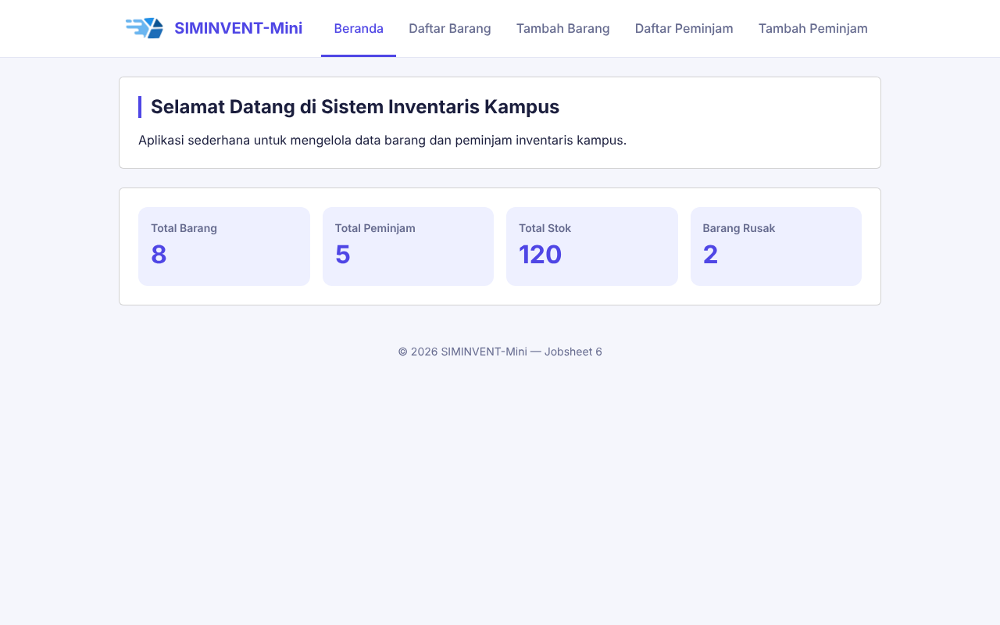
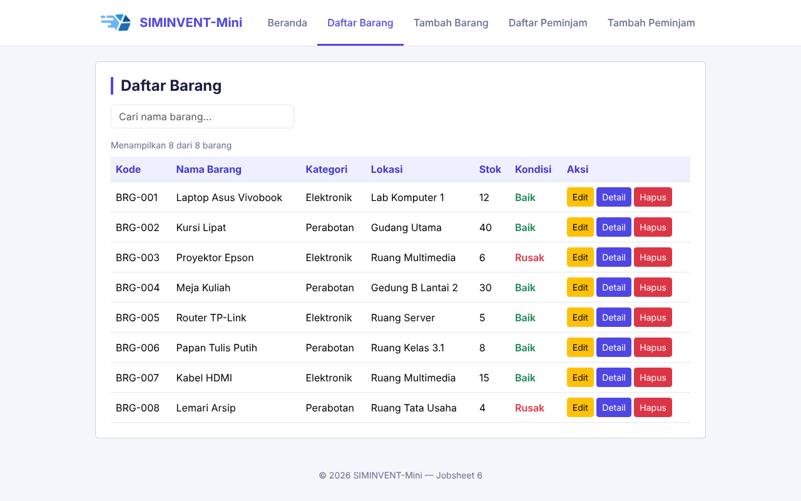
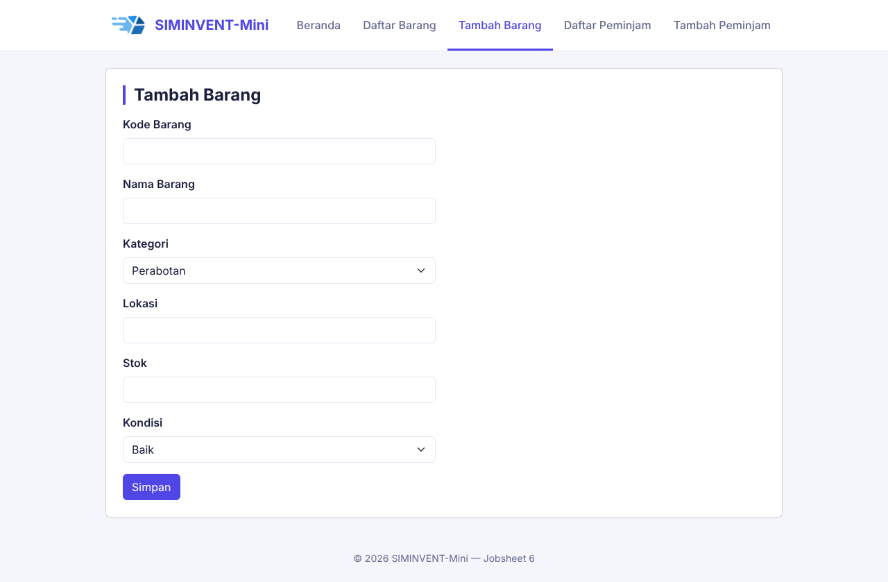
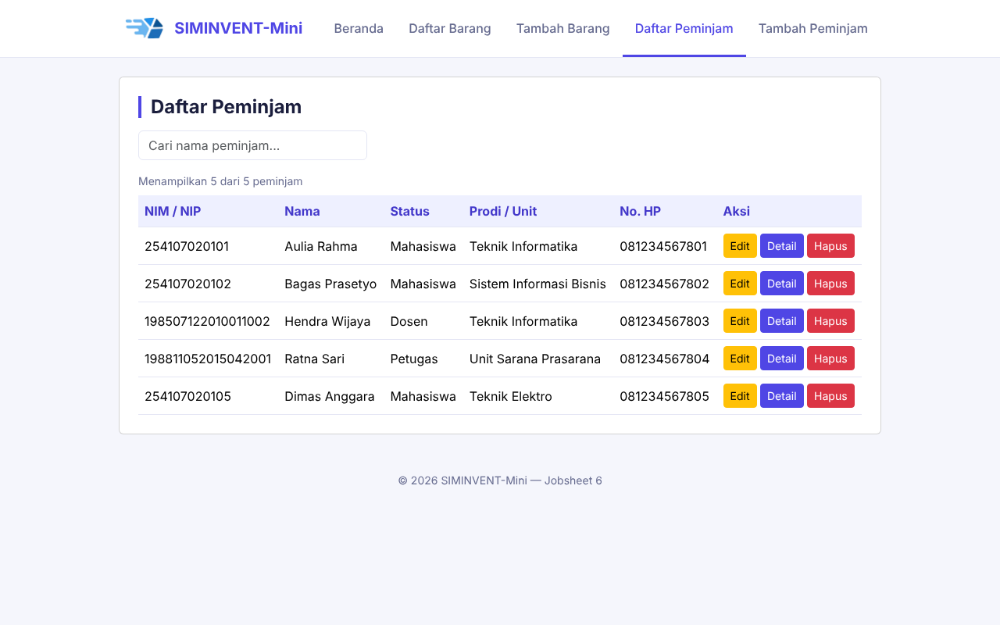
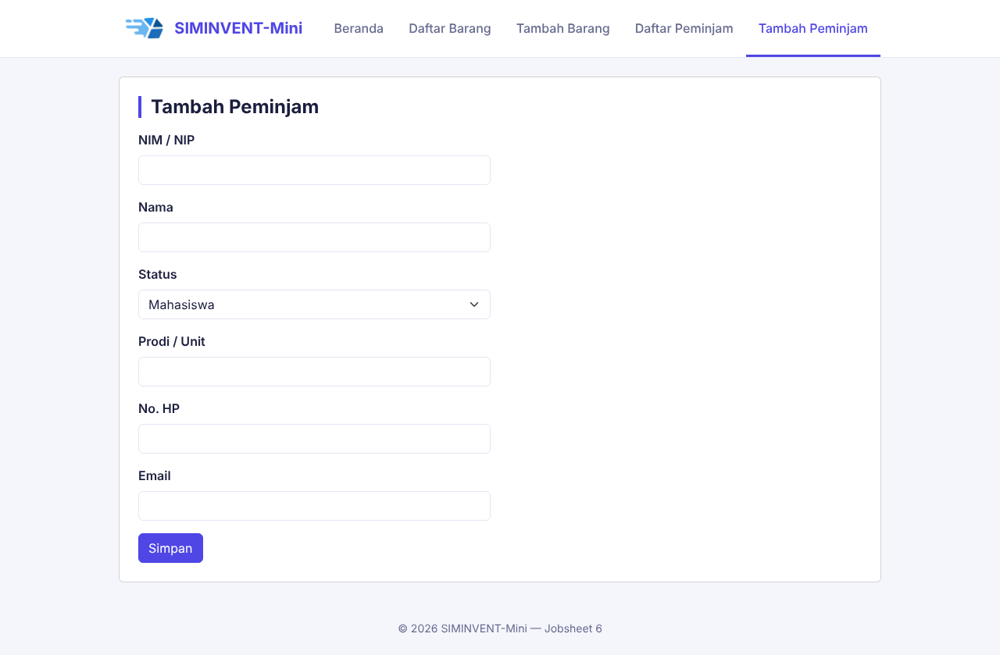

# Desain-Pemrograman-Web

# Jobsheet 6 — Fetch API & JSON

Sub-CPMK: Menerapkan komunikasi asinkron (AJAX/fetch, JSON).

## Identitas

| Data | Keterangan |
|---|---|
| Nama | Daffa Rajendra Maulana |
| NIM | 254107020181 |
| Mata Kuliah | Desain Pemograman Web |
| Kelas | TI - 2D |

## Tujuan

Mengambil dan menampilkan data secara asinkron menggunakan `fetch` dan JSON. File JSON statis dipakai sebagai pengganti sementara API, sebelum back-end sungguhan (PHP dan PostgreSQL) tersedia pada jobsheet berikutnya. Pola `fetch` yang dipelajari di sini akan dipakai ulang untuk memanggil endpoint PHP.

## Perubahan dari Jobsheet 5

- Ditambahkan `data/barang.json` (8 objek barang) dan `data/peminjam.json` (5 objek peminjam).
- `barang/list.html` dan `peminjam/list.html`: `<tbody>` dikosongkan. Baris tabel sekarang dibuat oleh `assets/js/barang.js` dan `assets/js/peminjam.js` dari hasil `fetch`.
- Ditambahkan **loading indicator** (`#loading-indicator`) yang tampil selama proses fetch. Delay 600 ms disimulasikan dengan `setTimeout` agar loading terlihat.
- Ditambahkan **penanganan error** (`try/catch`): jika fetch gagal, tabel menampilkan pesan "Gagal memuat data".
- `assets/js/app.js`: konfirmasi hapus diubah ke **event delegation**, dan ditambah helper `buatBaris`, `buatTeks`, dan `tampilkanPesan` untuk membuat baris tabel.
- Footer semua halaman diperbarui menjadi Jobsheet 6.

## Cara Kerja

1. Saat halaman dimuat, `barang.js` menampilkan loading indicator dan mengosongkan `<tbody>`.
2. `fetch("../data/barang.json")` mengambil data. Jika respons tidak OK (`res.ok`), error dilempar.
3. `res.json()` mengubah isi file menjadi array objek JavaScript.
4. Setiap objek dirender menjadi satu `<tr>` lewat `createElement`. Isi sel diatur lewat `append`, sedangkan kondisi dibuat sebagai teks berwarna oleh `buatTeks`.
5. Blok `finally` menyembunyikan loading indicator dan memperbarui counter, baik fetch berhasil maupun gagal.

Fungsi utamanya memakai **`async/await`**. Versi `.then()` yang setara:

```js
fetch("../data/barang.json")
    .then(function (res) { return res.json(); })
    .then(function (daftar) { /* render baris */ })
    .catch(function (err) { /* tampilkan pesan gagal */ });
```

`await` membuat kode terbaca berurutan dari atas ke bawah, sedangkan `.then()` menyambung fungsi secara berantai. Keduanya melakukan hal yang sama.

## Tugas Mandiri

`data/peminjam.json` dan `assets/js/peminjam.js` dibuat dengan pola `fetch` yang sama untuk halaman Daftar Peminjam.

## Kriteria Penilaian

| Kriteria | Pemenuhan |
|---|---|
| Data tampil dari JSON tanpa hardcode di HTML | `<tbody>` kosong di HTML, baris dibuat oleh JavaScript |
| Penanganan loading dan error | `#loading-indicator` dan `try/catch/finally` |
| Memakai `async/await` minimal di satu tempat | `barang.js` dan `peminjam.js` |

## Struktur Folder

```
jobsheet-06/
├── assets/
│   ├── css/style.css
│   ├── img/
│   └── js/
│       ├── app.js          → hamburger, validasi, pencarian, hapus, helper tabel
│       ├── barang.js       → fetch dan render Daftar Barang
│       └── peminjam.js     → fetch dan render Daftar Peminjam
├── barang/
│   ├── list.html
│   └── tambah.html
├── data/
│   ├── barang.json
│   └── peminjam.json
├── docs/
│   └── wireframe.md
├── dokumentasi/            → Screenshot hasil
├── peminjam/
│   ├── list.html
│   └── tambah.html
├── index.html
└── README.md
```

## Cara Menjalankan

**Penting:** `fetch()` ke file lokal diblokir browser jika halaman dibuka langsung dengan `file://` (klik dua kali). Jalankan lewat server lokal:

- **VS Code:** pasang ekstensi *Live Server*, klik kanan `index.html`, lalu pilih *Open with Live Server*.
- **Terminal:**
  ```bash
  python -m http.server 8000
  ```
  lalu buka `http://localhost:8000/index.html`.

## Cara Menguji

1. Buka **Daftar Barang**: loading muncul sebentar, lalu 8 barang tampil dari JSON.
2. Buka **Daftar Peminjam**: 5 peminjam tampil dari JSON.
3. Ketik di kolom cari: tabel tersaring dan counter berubah.
4. Klik **Hapus** pada baris yang dibuat dinamis: dialog konfirmasi muncul, baris hilang, counter berkurang.
5. **Uji error:** ubah sementara nama file di `fetch("../data/barang.json")` menjadi nama yang salah (misalnya `barangg.json`), lalu muat ulang. Tabel menampilkan pesan "Gagal memuat data". Kembalikan nama file setelah selesai.
6. Buka Console (**F12**) dan pastikan tidak ada error selain saat pengujian error.

## Dokumentasi

### Beranda


### Daftar Barang


### Tambah Barang


### Daftar Peminjam


### Tambah Peminjam



## Kesimpulan

Dengan `fetch` dan JSON, data tidak lagi ditulis manual di HTML, sehingga tampilan dan data terpisah. Halaman kini memberi umpan balik saat data sedang dimuat (loading) dan saat pengambilan data gagal (pesan error). Pola ini akan dipakai kembali ketika data berasal dari endpoint PHP dan database pada jobsheet berikutnya, dengan perubahan utama hanya pada alamat yang dipanggil oleh `fetch`.
